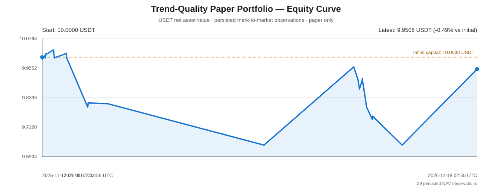

# MEXC Paper Performance Report

Generated: 2026-11-17 20:24:04.893 UTC  
Account: mexc-usdt-forward-10usdt-v2  
Strategy generation: trend-quality-daily-cross-sectional-v2-10usdt  
Workflow run: [44168781315](https://github.com/takenthatusernameis-collab/MARKET-NEUTRAL-TREND-QUALITY-INDICATOR-CROSS-SECTIONAL-RELATIVE-MOMENTUM/actions/runs/44168781315) (run #64, attempt 1; outcome: success)

This standalone report is rebuilt from the dedicated state branch after every MEXC paper workflow run. The complete source event chain is verified before publication to main.

## Current account snapshot

| Metric | Current value |
|---|---:|
| Initial capital | 10.00000000 USDT |
| **Net asset value (NAV)** | **9.79379972 USDT** |
| Total return from initial capital | -2.0620% |
| Cash | 9.99879972 USDT |
| Unrealized P&L | -0.20500000 USDT |
| Realized gross P&L | 0.00000000 USDT |
| Fees paid | 0.00170540 USDT |
| Confirmed funding | 0.00050512 USDT |
| Partial realized net P&L | 0.00000000 USDT |
| Open positions | 2 |
| Fully closed position trades | 0 |
| Closed-trade win rate | Unavailable — sample gate not met |
| Gross exposure | 1.8723× NAV |
| Net exposure | 0.1647× NAV |
| Long / short notional | 8.36200000 / 9.97500000 USDT |

Latest portfolio valuation: 2026-11-17 20:23:44.476 UTC.
Latest saved account event: 2026-11-17 20:23:44.476 UTC.

## Risk and performance metrics

| Metric | Result | Basis / sample gate |
|---|---:|---|
| Sortino ratio | Unavailable — at least 20 daily returns and 5 negative returns required | Daily NAV returns; minimum 20 returns and 5 negative returns |
| Sharpe ratio | Unavailable — at least 30 daily returns required | Daily NAV returns; minimum 30 returns |
| CAGR | Unavailable — at least 365 elapsed calendar days required | At least 365 elapsed calendar days |
| Calmar ratio | Unavailable — sample gate not met | CAGR divided by daily-equity drawdown |
| Annualized daily volatility | Unavailable — at least 30 daily returns required | Minimum 30 daily returns |
| Daily-equity maximum drawdown | Unavailable — sample gate not met | Daily UTC equity series |
| Maximum drawdown duration | Unavailable — sample gate not met | Daily UTC equity series |
| Recovery period after maximum drawdown | Unavailable — sample gate not met | Requires recovery to the prior peak |
| Closed-trade expectancy | Unavailable — sample gate not met USDT | Fully closed position trades only |
| Profit factor | Unavailable — sample gate not met | Fully closed position trades only |
| Current risk-window drawdown | -2.3520% | Versus current risk-window peak 10.02969460 USDT |

**Lifetime / cross-session maximum drawdown:** -3.9103%.
**Worst individual risk-session maximum drawdown:** -3.9103%.

Risk-session drawdown resets only at a successful new-pair entry, daily rebalance or UTC-day rollover. Lifetime drawdown is measured from original capital across all sessions and never resets.

### Maximum drawdown by risk session

| Session | Start (UTC) | Starting NAV | Latest NAV | Session return | Maximum drawdown | Marks |
|---:|---|---:|---:|---:|---:|---:|
| 1 | 2026-11-17 00:00:00.000 UTC | 10.00000000 | 9.79379972 | -2.0620% | -3.9103% | 25 |

Lifetime drawdown peak: 2026-11-17 01:51:41.256 UTC.
Lifetime drawdown trough: 2026-11-17 14:19:07.961 UTC (NAV 9.63749972 USDT).

## Equity curve

All persisted mark-to-market observations (25 points):

The SVG uses the same hash-chain-verified mark-to-market NAV observations shown in the full history below. The dashed line marks original account capital.

Observed NAV range: 9.63749972 to 10.02969460 USDT.
Daily-equity observations: 1; daily metric status: INSUFFICIENT_DAILY_EQUITY_HISTORY (1 daily return observations).

### Daily equity observations

| UTC timestamp | NAV (USDT) |
|---|---:|
| 2026-11-16 00:00:00.000 UTC | 9.99529460 |

### Full mark-to-market equity history

| Timestamp (UTC) | NAV (USDT) | ROI from initial capital | Risk-window drawdown | Long notional | Short notional |
|---|---:|---:|---:|---:|---:|
| 2026-11-17 01:11:31.864 UTC | 10.00000000 | 0% | 0% | 0.00000000 | 0.00000000 |
| 2026-11-17 01:12:02.711 UTC | 9.99139460 | -0.08605400% | -0.08605400% | 8.52260000 | 9.93750000 |
| 2026-11-17 01:21:45.489 UTC | 10.00649460 | 0.06494600% | 0% | 8.53020000 | 9.93000000 |
| 2026-11-17 01:22:10.989 UTC | 10.00049460 | 0.00494600% | -0.0599610576914716967918016000% | 8.52920000 | 9.93500000 |
| 2026-11-17 01:22:42.301 UTC | 9.99649460 | -0.03505400% | -0.0999350961524528279863359900% | 8.53020000 | 9.94000000 |
| 2026-11-17 01:23:18.334 UTC | 10.00349460 | 0.03494600% | -0.0299805288457358483959008000% | 8.52720000 | 9.93000000 |
| 2026-11-17 01:23:50.444 UTC | 10.01269460 | 0.12694600% | 0% | 8.52640000 | 9.92000000 |
| 2026-11-17 01:26:57.853 UTC | 10.01229460 | 0.12294600% | -0.0039949285979420564769847300% | 8.52600000 | 9.92000000 |
| 2026-11-17 01:51:41.256 UTC | 10.02969460 | 0.29694600% | 0% | 8.53340000 | 9.91000000 |
| 2026-11-17 01:54:44.226 UTC | 9.99699460 | -0.03005400% | -0.3260318614287617491364094000% | 8.53320000 | 9.94250000 |
| 2026-11-17 01:55:24.172 UTC | 9.99699460 | -0.03005400% | -0.3260318614287617491364094000% | 8.53320000 | 9.94250000 |
| 2026-11-17 02:37:58.804 UTC | 10.01539460 | 0.15394600% | -0.1425766244168591135367172600% | 8.53160000 | 9.92250000 |
| 2026-11-17 02:38:43.277 UTC | 9.99659460 | -0.03405400% | -0.3300200187551074586059679200% | 8.53280000 | 9.94250000 |
| 2026-11-17 03:53:17.041 UTC | 9.79369460 | -2.06305400% | -2.353012822543968587039529600% | 8.50740000 | 10.12000000 |
| 2026-11-17 03:55:04.087 UTC | 9.81139460 | -1.88605400% | -2.176536860853170943011564880% | 8.50760000 | 10.10250000 |
| 2026-11-17 05:04:28.567 UTC | 9.80799972 | -1.92000275000% | -2.210385099861365669100233620% | 8.49620000 | 10.09500000 |
| 2026-11-17 14:19:07.961 UTC | 9.63749972 | -3.62500275000% | -3.910337160216224330499554790% | 8.45820000 | 10.22750000 |
| 2026-11-17 19:37:32.709 UTC | 9.95949972 | -0.40500275000% | -0.6998705125079282075049423700% | 8.39020000 | 9.83750000 |
| 2026-11-17 19:38:12.012 UTC | 9.95949972 | -0.40500275000% | -0.6998705125079282075049423700% | 8.39020000 | 9.83750000 |
| 2026-11-17 19:53:44.215 UTC | 9.90429972 | -0.95700275000% | -1.250236223543636114304018790% | 8.37500000 | 9.87750000 |
| 2026-11-17 19:58:21.340 UTC | 9.86879972 | -1.31200275000% | -1.604185186256817829727337860% | 8.36700000 | 9.90500000 |
| 2026-11-17 19:59:14.115 UTC | 9.87299972 | -1.27000275000% | -1.562309534330187880296973350% | 8.36620000 | 9.90000000 |
| 2026-11-17 20:07:29.575 UTC | 9.90229972 | -0.97700275000% | -1.270177010175364661651811410% | 8.37800000 | 9.88250000 |
| 2026-11-17 20:08:16.747 UTC | 9.91129972 | -0.88700275000% | -1.180443470332586198586744610% | 8.37700000 | 9.87250000 |
| 2026-11-17 20:23:44.476 UTC | 9.79379972 | -2.06200275000% | -2.351964684946638355269561250% | 8.36200000 | 9.97500000 |

## Open positions

| Symbol | Side | Quantity | Entry | Mark | Notional (USDT) | Unrealized P&L (USDT) | Entry UTC |
|---|---|---:|---:|---:|---:|---:|---|
| VSTOCK_USDT | long | 0.02 | 426.35 | 418.1 | 8.36200000 | -0.16500000 | 2026-11-17 01:11:31.864 UTC |
| BILL_USDT | short | 2500 | 0.003974 | 0.00399 | 9.97500000 | -0.04000000 | 2026-11-17 01:11:31.864 UTC |

## Full timestamped trade and funding history

Explicit fills and funding records are shown directly. Persisted before/after position changes are used as a backstop; where an event did not preserve an exact fill price or P&L, the note identifies the row as derived rather than inventing details.

| Timestamp (UTC) | Action | Symbol | Side | Quantity / Δ | Price | Fees (USDT) | Net P&L (USDT) | Funding (USDT) | Source / note |
|---|---|---|---:|---:|---:|---:|---:|---:|---|
| 2026-11-17 01:11:31.864 UTC | OPENED | VSTOCK_USDT | long | 0.02 | 426.35 | 0.00170540 | — | — | fills; paper_account_initialized |
| 2026-11-17 01:11:31.864 UTC | OPENED | BILL_USDT | short | 2500 | 0.003974 | — | — | — | fills; paper_account_initialized |
| 2026-11-17 04:00:00.000 UTC | FUNDING | BILL_USDT | — | — | 0.004041 | — | — | 0.00050512500 | funding_events; paper_portfolio_snapshot |

## Data integrity and operating boundary

Verified global event batches: **29**.
Events for this account/strategy generation: **26** (25 carry full account-state snapshots).
Latest global event-batch hash: fc8d6a9fbd5674198bfb154497ce462ece7e7a90356d4e2390f3b73dd18ebea9.
All batches were hash-verified and the complete parent-hash chain was checked for a single genesis, missing parents, duplicate identifiers and forks.
The archived $1 account generation is excluded; only the active $10 USDT account is reported.
Paper simulation only: no live orders, private exchange endpoints, credentials or wallet access.
Metrics remain unavailable until their documented sample gates are satisfied.
