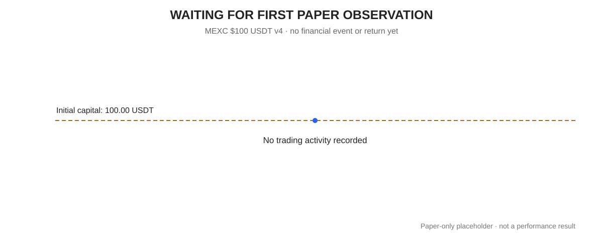

# ACTIVE PAPER STATUS — MEXC $100 USDT

**🟢 ACTIVE · PAPER ONLY · NO LIVE ORDERS**

**Correct workflow:** [▶ ACTIVE PAPER ACCOUNT — MEXC $100 USDT PAPER ONLY — MANUAL / AUTO](https://github.com/takenthatusernameis-collab/MARKET-NEUTRAL-TREND-QUALITY-INDICATOR-CROSS-SECTIONAL-RELATIVE-MOMENTUM/actions/workflows/mexc-paper-cycle.yml)

- Account: `mexc-usdt-forward-100usdt-v4`
- Strategy generation: `trend-quality-daily-cross-sectional-v4-100usdt`
- Starting capital: **100.00000000 USDT**
- Account state: **READY — AWAITING FIRST FINANCIAL WORKFLOW EVENT**
- First eligible candle: latest genuinely completed UTC daily candle; no account candle watermark has been consumed.
- Previous $50 simulations: archived, excluded from this account.

## Initial state

No v4 trades, fees, returns, open positions or performance observations have been created yet. The 100 USDT amount is the authorized starting capital, not a reported NAV after trading. The next eligible manual or scheduled cycle must verify the state recovery handshake, restore full market history, and pass data and simulated-execution gates before creating financial state.

## Primary path — equal exposure

The primary paper strategy sizes the long and short legs independently toward equal USDT notional, approximately 1× NAV per leg before MEXC contract-lot rounding.

## Alternative path — inverse-volatility sizing

The second curve is a **visual-only counterfactual**. It will reuse exactly the same primary-path selected symbols, directions and rebalance timestamps. The quieter asset will receive the larger share of the same initial 100 USDT equity budget. At each rebalance, a lagged 30-completed-day inverse-volatility allocation will be used; any estimated reduction in pair volatility will be translated into a leverage multiplier to bring modeled volatility back toward the equal-exposure path. The alternative has no independent trade journal and cannot submit orders.

The alternative curve is a model estimate, not an executable account. It will disclose missing-history fallbacks and does not assume that nonlinear market impact, liquidation risk, borrowing or exchange leverage constraints are costless.

## Workflow and evidence

The correct active workflow is the one linked above. It runs manually or on its five-minute / 00:01 UTC schedule. Candle data and old event records are preserved; only the new v4 account has a clean decision watermark. A failed history or execution gate must be reported as blocked, not counted as a successful strategy rebalance.
